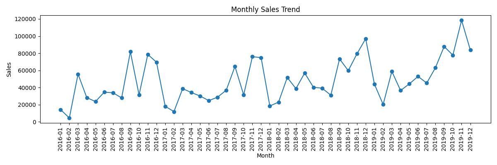
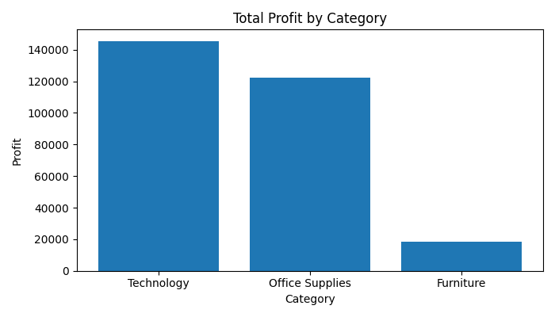

# Superstore Sales Analysis with Python

Retail sales and profitability analysis using Python, Pandas, NumPy, Matplotlib and Seaborn.

## Overview
This project explores retail transactions to identify sales trends, profitability drivers, discount patterns, customer segments and shipping performance.

## Workflow
- Inspect data quality, duplicates and missing values.
- Handle unknown postal codes and inspect outliers using IQR without removing plausible transactions.
- Engineer shipping duration, profit margin and sales performance categories.
- Analyze sales, profit, regions, segments, discounts, correlations and monthly trends.
- Export cleaned data, charts and a KPI summary.

## Results
| Metric | Value |
| --- | ---: |
| Sales | $2,297,200.86 |
| Profit | $286,397.02 |
| Orders | 5,009 |
| Customers | 793 |
| Average shipping duration (transaction-level) | 3.96 days |

Technology leads sales and profit; furniture generates substantial sales but comparatively lower profit. Tables are a loss-making sub-category. Higher discounts are associated with weaker profitability in the dataset; this is not evidence of causation.

## Visualizations

## Files
- `superstore_sales_analysis.ipynb`: analysis notebook.
- `Sample-Superstore-2019.xlsx`: source workbook.
- `cleaned_superstore.csv`: processed dataset.
- `charts/`: exported visualizations.
- `summary_report.txt`: KPI summary.

## Run locally
Install dependencies with `python -m pip install -r requirements.txt`, then open the notebook in Jupyter from the repository root and run all cells. The included workbook is the primary input.

## Scope
This is an educational analysis of a sample retail dataset, not a live retail reporting system. Original dataset redistribution rights have not been independently verified.
